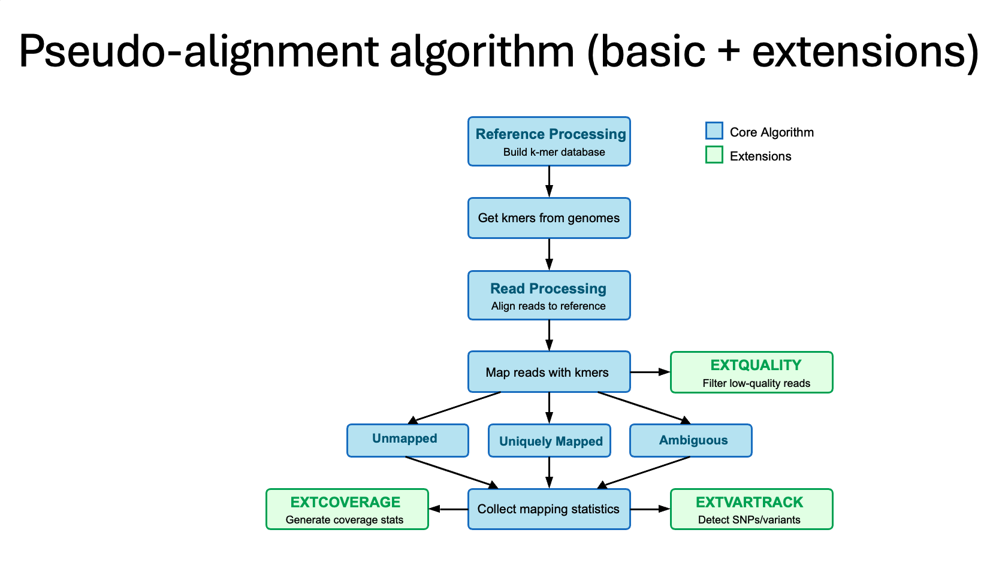

# Genomic Pseudo-Aligner


A Python bioinformatics tool for genomic pseudo-alignment, variant calling (SNPs), and coverage analysis. Pure Python standard library, no runtime dependencies.

## 🚀 Features

* **Pseudo-Alignment:** Maps reads to one or more reference genomes by looking up their k-mers in a hash index and counting hits per genome. Reads from either strand are mapped.
* **Quality Control (EXTQUALITY):** Filters low-quality reads and k-mers based on Phred33 scores before alignment.
* **Coverage Analysis (EXTCOVERAGE):** Per-position coverage from uniquely vs. ambiguously mapped reads.
* **Variant Tracking (EXTVARTRACK):** Reports single-base differences (SNPs) between uniquely mapped reads and the reference, with depth, per-allele counts and allele frequency.

## 📦 Installation

```bash
pip install git+https://github.com/spitzyo/genomic-pseudo-aligner
genomic-pseudo-aligner --help
```

Or run it straight from a checkout, with no install:

```bash
git clone https://github.com/spitzyo/genomic-pseudo-aligner
cd genomic-pseudo-aligner
python3 main.py --help
```

`genomic-pseudo-aligner`, `python3 main.py` and `python3 -m genomic_pseudo_aligner` take the same arguments.

To use it as a library, import from the package, e.g. `from genomic_pseudo_aligner.aligner import Aligner, Read`.

> **Upgrading from 0.2 or earlier:** the code moved into the `genomic_pseudo_aligner` package in 0.3.0. `.kdb` and `.aln` files saved by earlier versions can't be read any more; rebuild them with the `reference` / `align` tasks.

## 🛠️ System Architecture

All code lives in the `genomic_pseudo_aligner` package. The `main.py` at the repo root only calls `genomic_pseudo_aligner.cli`.

| Module | Description |
| :--- | :--- |
| `aligner.py` | `Read` and `Aligner`: k-mer counting, strand choice, unique/ambiguous/unmapped decision, offset voting and mismatch check. |
| `kmers.py` | `Reference` genomes and the `KmerCollection` index (k-mer → genomes and positions; genome identifier → `Reference`). |
| `extcoverage.py` | Per-position coverage depth and statistics for mapped reads. |
| `extvartrack.py` | Per-allele variant counts, read depth, and quality / depth / allele-frequency filters. |
| `helper_functions.py` | FASTA/FASTQ reading, `.kdb`/`.aln` saving and loading, and error handling. |
| `tasks.py` | The `reference`, `dumpref`, `align` and `dumpalign` tasks. |
| `cli.py` | Command-line arguments; dispatches to the tasks. |

## 📊 Algorithm Design



1. **Reference index.** Every k-mer of every reference genome (k-mers containing `N` are skipped) is stored in a dictionary mapping the k-mer to the genomes and 0-based positions where it occurs. A k-mer found in exactly one genome is *specific*.
2. **Strand.** Each read is looked up twice: as given, and as its reverse complement. See [Strand handling](#-strand-handling).
3. **Genome assignment.** For the chosen orientation, count specific k-mer hits and total k-mer hits per genome.
   * No specific hits → `unmapped`.
   * If the top genome leads the runner-up by at least `--unique-threshold` (default 1) specific hits, and no genome has more than `--ambiguous-threshold` (default 1) more total hits than it → `unique` to the top genome.
   * Otherwise → `ambiguous`, mapped to every candidate genome.
4. **Position.** Each k-mer hit votes for a read start position: the k-mer's reference position minus its offset in the read. The position with the most votes wins; ties go to the lower mismatch rate, then the smaller position. The start may be negative, and the read may run past the genome end. Only the bases that overlap the genome are compared.
5. **Mismatch check.** The read is compared base by base with the reference at that position. A genome is kept only if at most 10% of the overlapping bases differ. A read with no genome left is `unmapped`.

Reads with no usable k-mers (all contain `N`, all filtered by EXTQUALITY, or shorter than k) get the status `filtered`.

## 🧭 Strand handling

Reads may come from either strand of the reference. For every read the aligner counts k-mer hits for the sequence as given (`+`) and for its reverse complement (`-`). It keeps the orientation with more specific k-mer hits, then more total hits; a full tie keeps `+`. The result is stored on the read:

* `read.strand`: `'+'`, `'-'`, or `None` when the read is unmapped or filtered.
* `read.positions`: `{genome_id: start}`, the 0-based reference position of the first base of the read in the chosen orientation, for each mapped genome.

Both are saved with the reads in the `.aln` file.

Everything after the strand choice (position voting, mismatch check, coverage and variant calling) uses the chosen orientation. For a minus-strand read the sequence is reverse complemented and its quality string reversed, so variants are always reported in reference orientation: the reference base, alternate base, position and base quality all refer to the reference's forward strand.

## 🧬 Variant Detection (SNP)

Variant detection uses only **uniquely mapped** reads. Each one is compared with the reference at its aligned position:

```text
Reference Genome:  ... A  T  C  G  [T]  A  G  C ...
                       |  |  |  |   X   |  |  |
Aligned Read:      ... A  T  C  G  [A]  A  G  C ...
                                    ^
                               SNP Detected
```

* **Depth** at a position is the number of uniquely mapped reads covering it, whether they show the reference base or not.
* Each alternate base at a position is counted separately: if some reads show `A` and others `G` where the reference has `C`, you get two variants.
* A base below `--min-variant-quality` (default 20), or an `N`, still counts toward depth but not toward any allele count.
* A variant is reported if `depth >= --min-variant-coverage` (default 10) and `allele_frequency >= --min-variant-af` (default 0).

## 💻 Usage Examples
* Note: The commands below use example filenames. Please replace them with your own data.

### 1. Basic Alignment
Align reads to a reference genome and save the result to an `.aln` file.

```bash
genomic-pseudo-aligner -t align \
  -g example_ref_mid.fa \
  -k 12 \
  -a output.aln \
  --reads s_example_k150_n10k.fq
```

### 2. Alignment with Variant Detection
Report variants seen in at least 5 reads covering the position, at an allele frequency of 20% or more.

```bash
genomic-pseudo-aligner -t dumpalign \
  -g reference_for_vartrack.fa \
  -k 5 \
  --reads reads_for_vartrack.fq \
  --detect-variants \
  --min-variant-coverage 5 \
  --min-variant-af 0.2 \
  --min-variant-quality 20
```

### 3. Coverage Statistics

```bash
genomic-pseudo-aligner -t dumpalign \
  -g example_ref_mid.fa \
  -k 12 \
  --reads s_example_k150_n10k.fq \
  --coverage
```

### Tasks

| Task | What it does |
| :--- | :--- |
| `reference` | Builds the k-mer index from `-g` (FASTA) with `-k` and saves it to `-r` (`.kdb`). |
| `dumpref` | Prints the index from `-r`, or builds it from `-g`/`-k` and prints it. |
| `align` | Aligns `--reads` (FASTQ) against `-r`, or against `-g`/`-k`, and saves reads and summary to `-a` (`.aln`). |
| `dumpalign` | Prints alignment statistics from `-a`, or aligns `--reads` and prints them, plus coverage / variants when enabled. |

Where a task needs a reference, give either `-r` (a `.kdb` file) or `-g` with `-k`. If both are given, `-r` is used and `-g`/`-k` are ignored. The reference is loaded or built once per run.

### Options

| Option | Meaning |
| :--- | :--- |
| `-m`, `--unique-threshold` | Specific k-mer lead the top genome needs over the runner-up to be `unique` (default 1). |
| `-p`, `--ambiguous-threshold` | Max total k-mer lead another genome may have over the top genome before the read is `ambiguous` (default 1). |
| `--min-read-quality` | Drop reads whose mean Phred quality is below this. |
| `--min-kmer-quality` | Drop k-mers whose mean Phred quality is below this. |
| `--max-genomes` | Drop k-mers found in more than this many genomes. |
| `--coverage` | Print coverage statistics. `--full-coverage` adds per-position arrays; `--min-coverage` (default 1) is the depth a base needs to count as covered. |
| `--genomes` | Comma-separated genome identifiers to limit coverage / variant output to. |
| `--detect-variants` | Print variants. See `--min-variant-quality`, `--min-variant-coverage`, `--min-variant-af` above. |

`-k`, `-m`, `-p`, `--max-genomes` and `--min-coverage` must be positive integers; `--min-read-quality`, `--min-kmer-quality` and `--min-variant-coverage` integers >= 0; `--min-variant-quality` a number >= 0; `--min-variant-af` a number from 0 to 1. Ids in `--genomes` must exist in the reference.

## 🚦 Errors, Warnings and Exit Status

stdout only ever holds results (the JSON dumps). Errors and warnings go to stderr, one line each:

```text
genomic-pseudo-aligner: error: ref.fa: No such file or directory (while loading FASTA file)
genomic-pseudo-aligner: warning: reads.fq: skipped 2 malformed record(s); first at line 5: the quality and sequence lengths differ
```

| Exit status | Meaning |
| :--- | :--- |
| `0` | Success. There may still be warnings on stderr. |
| `1` | The task failed: an input file is missing, unreadable, corrupt or has nothing usable, or an output file can't be written. |
| `2` | Invalid command line: unknown task, missing or invalid option, wrong file extension, unknown `--genomes` id. |

**Input checks:**

* **FASTA** (`-g`): the first non-empty line must be a `>` header. Sequences are uppercased on load, so soft-masked references (lowercase repeats, as in UCSC and Ensembl downloads) work as is. A record with an empty header, no sequence, or any character other than `A`, `C`, `G`, `T`, `N` (in either case) is skipped with a warning. The run fails if no record is usable, or if no k-mer can be built (every genome shorter than `-k`). No `.kdb` is written on failure.
* **FASTQ** (`--reads`): read sequences are uppercased on load, so mixed-case reads are accepted. Records with a header not starting with `@`, a third line not starting with `+`, an empty sequence, characters other than `ACGTN` (in either case), or a quality string of a different length are skipped, with one warning giving the count and the first problem. The run fails if no read is usable.
* **Compressed or binary input**: a `.gz` FASTA/FASTQ that isn't valid gzip data (or is truncated), or a binary file given as FASTA/FASTQ, fails with a message naming the file.
* **`.kdb` / `.aln`**: a file that is not one of ours, is corrupt or truncated, holds the wrong kind of data (e.g. an `.aln` given as `-r`), or was saved before 0.3.0 fails with a message saying which.

Warnings without failure: `align` without `-a` (nothing is saved), `--genomes` without `--coverage` or `--detect-variants` (no effect), and a genome shorter than `-k` (no k-mers).

## 📄 Output Fields

All dumps are JSON printed to stdout.

### `dumpref`

* `Kmers.<kmer>.<genome_id>`: sorted 0-based positions of the k-mer in that genome.
* `Summary.<genome_id>`:
  * `total_bases`: genome length.
  * `unique_kmers`: distinct k-mers found only in this genome.
  * `multi_mapping_kmers`: distinct k-mers also found in other genomes.

### `dumpalign`: alignment

* `Statistics`:
  * `unique_mapped_reads`, `ambiguous_mapped_reads`, `unmapped_reads`: read counts by status (`filtered` reads are not counted here).
  * With `--min-read-quality`, `--min-kmer-quality` or `--max-genomes`:
    * `filtered_quality_reads`: reads dropped for low mean quality.
    * `filtered_quality_kmers`: k-mers dropped for low quality or because they contain `N`.
    * `filtered_hr_kmers`: k-mers dropped by `--max-genomes` (or not in the index).
* `Summary.<genome_id>`: `unique_reads` and `ambiguous_reads` mapped to the genome. Genomes with no reads are listed with zeros.

### `dumpalign --coverage`

Coverage counts every reference base a mapped read covers at its chosen position (clipped to the genome). An ambiguous read adds coverage to each genome it maps to.

* `Coverage.<genome_id>`:
  * `covered_bases_unique` / `covered_bases_ambiguous`: bases covered by at least `--min-coverage` unique / ambiguous reads.
  * `mean_coverage_unique` / `mean_coverage_ambiguous`: mean depth over the whole genome, rounded to 1 decimal.
* `Details.<genome_id>` (with `--full-coverage` only): `unique_cov` and `ambiguous_cov`, one depth value per reference position.

### `dumpalign --detect-variants`

```json
{
    "Variants": {
        "g1": {
            "200": [
                {"reference": "C", "alternate": "A", "depth": 10, "ref_count": 6,
                 "alt_count": 3, "allele_frequency": 0.3, "quality_score": 40.0},
                {"reference": "C", "alternate": "G", "depth": 10, "ref_count": 6,
                 "alt_count": 1, "allele_frequency": 0.1, "quality_score": 40.0}
            ]
        }
    },
    "Statistics": {
        "g1": {"total_variants": 2, "reported_variants": 2, "filtered_variants": 0}
    }
}
```

* `Variants.<genome_id>.<position>`: a list with one entry per alternate base at that 0-based reference position:
  * `reference`: reference base (forward strand).
  * `alternate`: alternate base (forward strand).
  * `depth`: uniquely mapped reads covering the position.
  * `ref_count`: those reads showing the reference base.
  * `alt_count`: those reads showing this alternate base at or above `--min-variant-quality`.
  * `allele_frequency`: `alt_count / depth`, rounded to 4 decimals.
  * `quality_score`: mean Phred quality of the bases counted in `alt_count`.
  * `depth - ref_count - (sum of alt_count)` is the number of reads showing an `N` or a low-quality non-reference base.
* `Statistics.<genome_id>`, counting (position, alternate base) pairs:
  * `total_variants`: candidates seen.
  * `reported_variants`: candidates that pass the depth and allele-frequency filters.
  * `filtered_variants`: candidates that don't (`total_variants - reported_variants`).

## 💡 Key Design and Coding Decisions

* **Decorators for I/O:** Custom decorators (`@handle_f_read`, `@handle_f_write`) handle errors across file operations, keeping the code clean.
* **Encapsulation:** Extensions (Coverage, Variant Tracking) live in their own modules/classes so the core `Aligner` stays small.
* **O(1) Lookups:** `KmerCollection` uses dictionaries for constant-time k-mer and genome lookups, plus a list that preserves the FASTA genome order for output.
* **Depth without per-base arrays:** the variant tracker stores each read's start and end and answers depth queries with binary search, so memory grows with the number of reads, not the genome length.

## 🛠️ Development & Testing

```bash
pip install -r requirements.txt
python3 -m pytest
```

Benchmark on a synthetic genome (1 Mb by default):

```bash
python3 benchmarks/bench_align.py --reads 1000 --minus-fraction 0.5
```

## ⚠️ Algorithm Limitations
As a pseudo-aligner, this tool is designed for speed and coverage estimation, not exact alignment.
* **Indels:** Insertions and deletions are not handled. A read is compared with the reference base by base at a single offset, so an indel shows up as a run of mismatches and the read may fail the 10% mismatch check.
* **Heuristic:** Genome assignment is based on k-mer hit counts only.
* **Substitutions only:** Variant tracking reports single-base substitutions.
